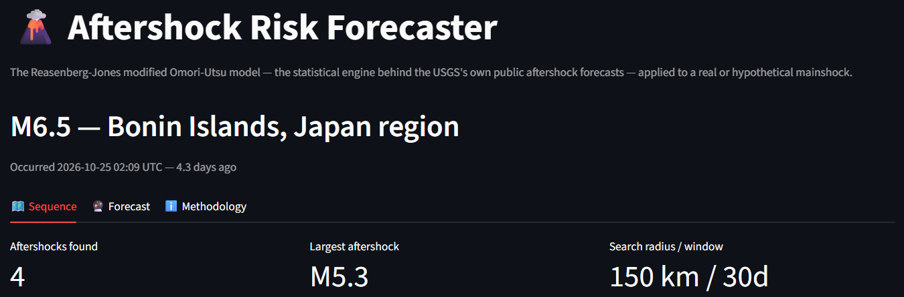
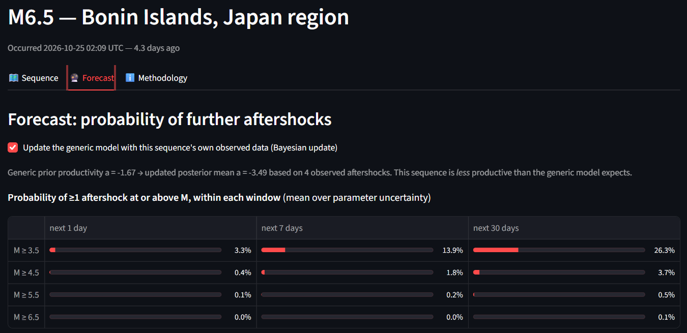
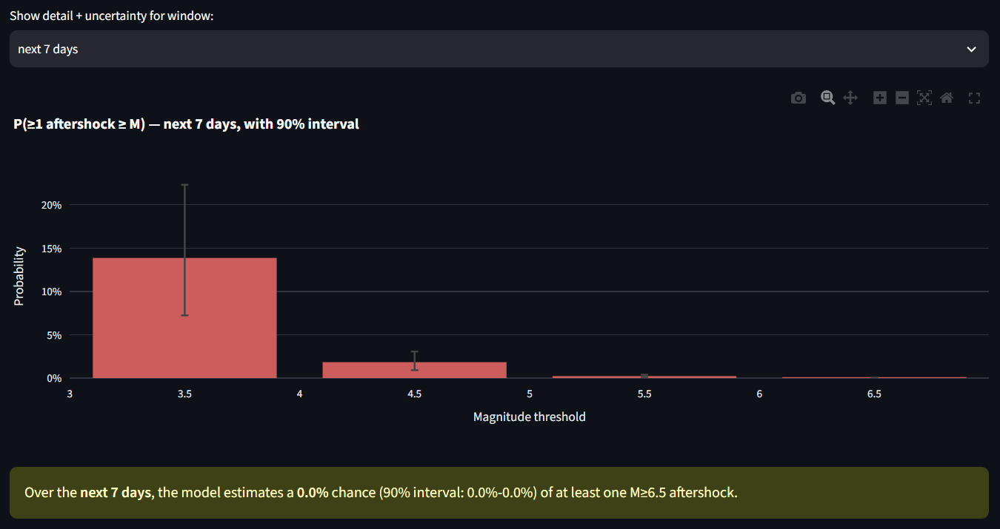
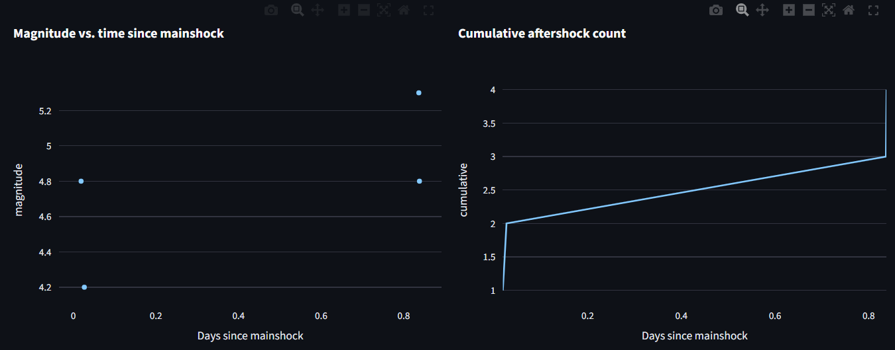
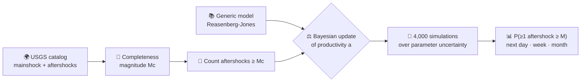

<div align="center">

# 🌋 Aftershock Risk Forecaster

**A big earthquake just hit. How likely is another strong shake in the next day, week or month?**
Pick any recent significant earthquake and get a probabilistic aftershock forecast from live USGS data.




</div>

## ⚡ Example: M6.5 Bonin Islands, Japan (25 Oct 2026), forecast 4.3 days later

| Chance of at least one aftershock | next day | next 7 days | next 30 days |
|---|---|---|---|
| **M 4.5 or larger** | 9% | **34%** | 57% |
| **M 5.5 or larger** | 1.2% | 5% | 10% |
| **M 6.5 or larger** (as big as the mainshock) | 0.1% | **0.7%** | 1.4% |

> **In plain words:** about a 1-in-3 chance of another M4.5+ shake within a week, and well under 1% of one as big
> as the mainshock. The 90% intervals in the app show how uncertain each number is.

## 🔍 The catch this app handles: missing small earthquakes

Far from dense seismic networks, the global catalog misses small events. For this sequence the smallest aftershock
recorded was **M4.2**, although the search went down to M2.5. If you count those 4 aftershocks as if every M2.5+
event had been recorded, the model compares them with the **445** it expects and concludes the sequence is barely
active. Counted from the catalog's **completeness magnitude (M4.2)**, the model expects 12.6, and 4 is a quieter but
believable sequence.



The app now estimates the completeness magnitude for every sequence and updates the model only with events above it.

## 📸 The app

| | |
|---|---|
|  |  |
|  |  |

<sub>The screenshots were taken before the completeness fix, so they show the grey numbers above (posterior a = −3.49).</sub>

**Three tabs:** 🗺️ Sequence (map, magnitudes over time, cumulative count, observed vs model decay) ·
🔮 Forecast (probability table and chart with 90% intervals) · ℹ️ Methodology.
Pick a recent significant earthquake from the USGS feed, or enter a hypothetical one.

## 🧠 How it works



| Idea | In plain words |
|---|---|
| **Omori-Utsu decay** | Aftershocks are most frequent right after the mainshock and fade roughly as 1/time |
| **Gutenberg-Richter** | Each step down in magnitude means about 8× more earthquakes (b = 0.91) |
| **Reasenberg-Jones rate** | Combines the two: rate = 10^(a + b(M_main − M)) / (t + c)^p, using the generic California values |
| **Bayesian update** | Starts from the generic productivity `a` and moves it toward what this sequence has actually done |
| **Completeness Mc** | The smallest magnitude the catalog reliably records here, so only fully recorded events are counted |

## 🚀 Quick start

```bash
git clone https://github.com/harshadulshan/aftershock-forecaster.git
cd aftershock-forecaster
pip install -r requirements.txt
streamlit run app.py
```

No API key needed.

## ✅ Verified

```bash
python tests/verify_engine.py      # 37 checks, under a second, offline
```

- **Expected counts** match numerical integration of the rate on every window; magnitudes scale by exactly 10^b.
- **Bayesian update** equals prior × Poisson likelihood computed independently, and recovers the true productivity
  from 200 simulated sequences (mean error +0.001).
- **Completeness:** on a simulated catalog complete from M4.3, the estimate is the expected 4.5 (maximum curvature
  + 0.2), and counting from it recovers the true productivity, while counting from M2.5 underestimates it by more
  than 1 unit.
- **Mutation check:** 11 bugs were planted one at a time, and the tests caught all 11.

## ⚠️ Limitations

- **One generic parameter set (California) everywhere.** The USGS uses region-specific sets (Page et al., 2016); here
  the Bayesian update corrects toward each sequence's own behaviour once data exists.
- **Completeness is estimated roughly** for small sequences (the smallest magnitude found), and the catalog also
  misses overlapping events in the first hours after a big mainshock.
- **Statistics, not physics.** It says nothing about which fault will slip next.
- **Not an official forecast.** For real decisions, use the forecast on the USGS event page.

<details>
<summary><b>📂 Project structure & references</b></summary>

```
app.py               Streamlit interface (3 tabs)
aftershock_model.py  Reasenberg-Jones rate, expected counts, Bayesian update, Monte Carlo forecast, completeness
usgs_client.py       USGS significant-earthquake feed and catalog queries
tests/               verify_engine.py (37 checks)
docs/                animated SVGs and screenshots
```

- Reasenberg, P. A. & Jones, L. M. (1989). Earthquake hazard after a mainshock in California. *Science* 243,
  1173-1176.
- Reasenberg, P. A. & Jones, L. M. (1994). Earthquake aftershocks: update. *Science* 265, 1251-1252.
- Page, M. T. et al. (2016). Three ingredients for improved global aftershock forecasts. *Seismological Research
  Letters* 87(6), 1382-1396.
- Hardebeck, J. L. et al. (2019). Updated California aftershock parameters. *Seismological Research Letters* 90(1),
  262-270.
- Wiemer, S. & Wyss, M. (2000). Minimum magnitude of completeness in earthquake catalogs. *BSSA* 90(4), 859-869.
- Woessner, J. & Wiemer, S. (2005). Assessing the quality of earthquake catalogues. *BSSA* 95(2), 684-698.
- USGS Operational Aftershock Forecasting: earthquake.usgs.gov/data/oaf/background.php

</details>

<div align="center">

**Harsha Dulshan** · BSc (Hons) Management Information Systems, NSBM Green University
[GitHub](https://github.com/harshadulshan) · [LinkedIn](https://www.linkedin.com/in/harsha-kaldera/) · MIT License

</div>
